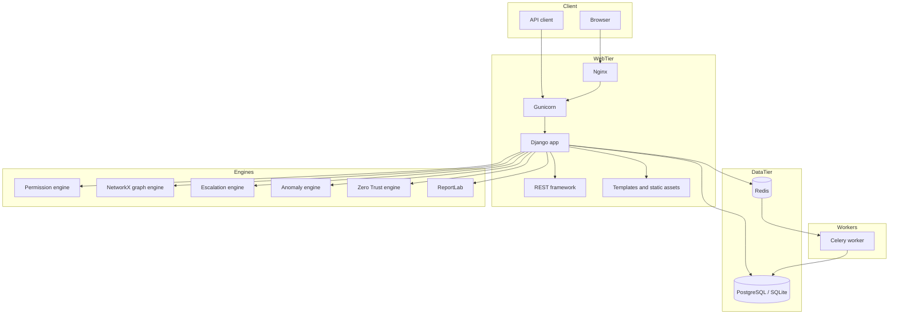
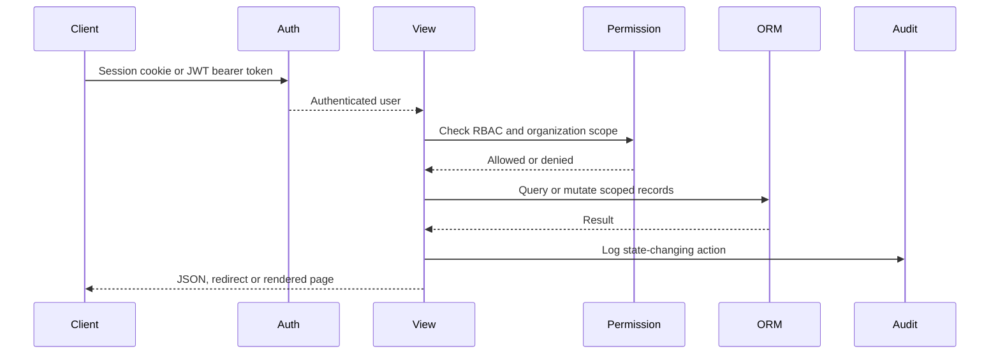
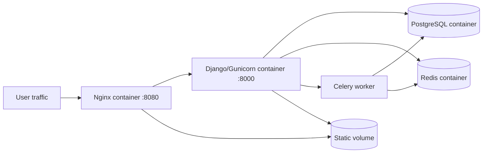
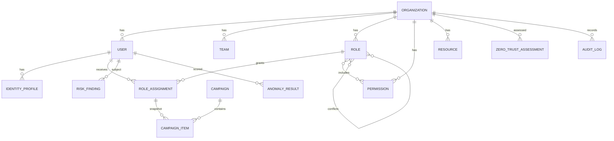
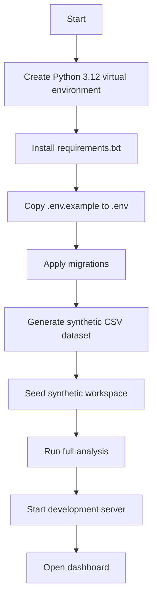
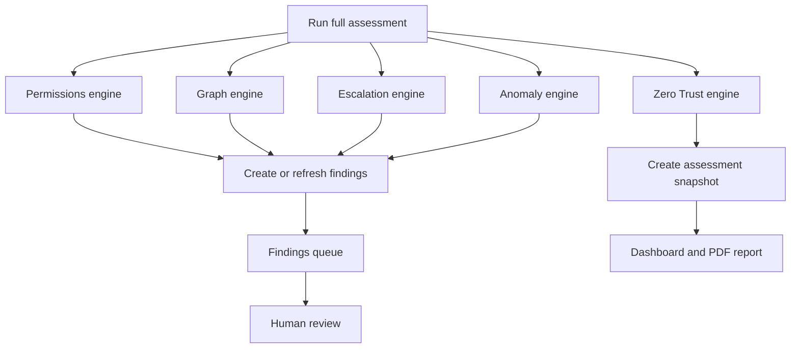
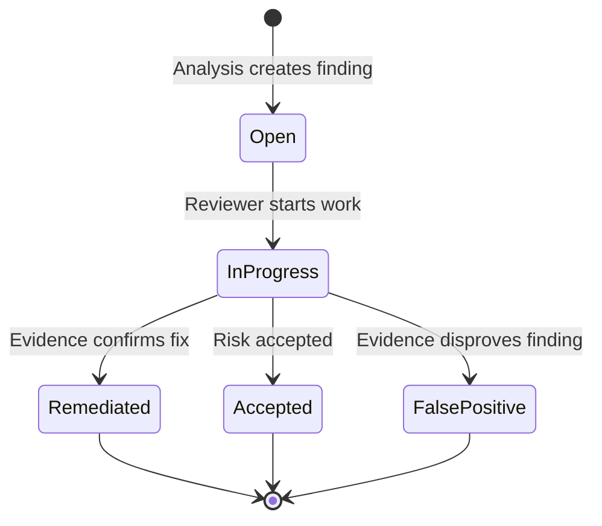
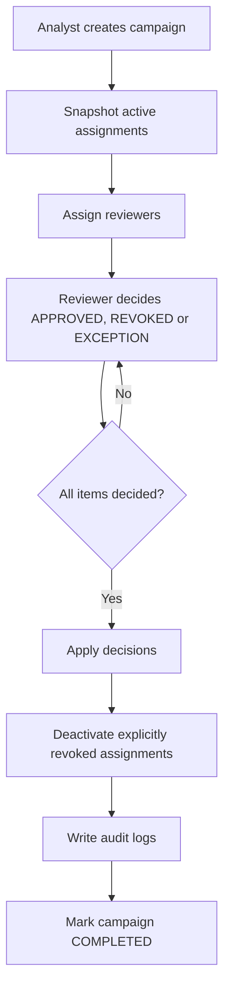
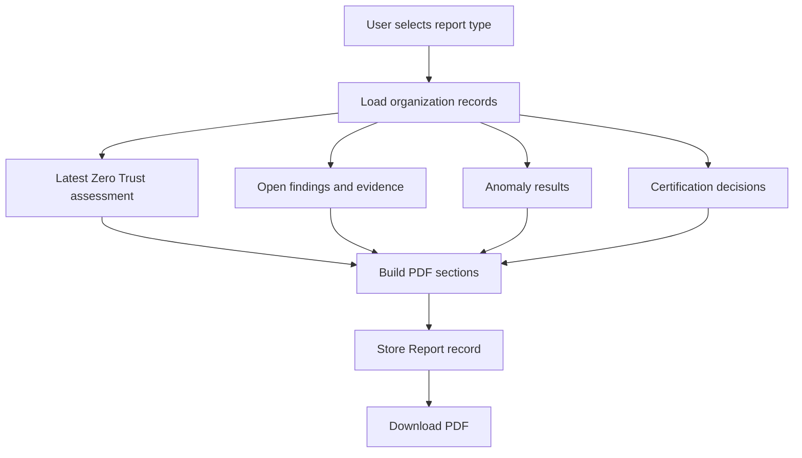
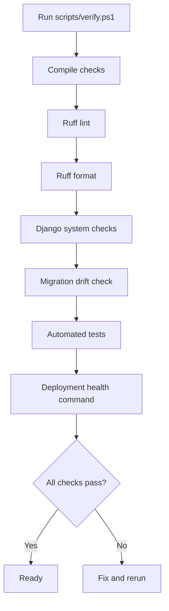

# IdentityForge

IdentityForge is a synthetic-data identity and access risk assessment platform built with Django, Django REST Framework, PostgreSQL, Celery, Redis, NetworkX, scikit-learn, pandas, Chart.js, Three.js and ReportLab. It models users, teams, roles, permissions, resources and access events, then produces evidence-backed findings for human review.

> Synthetic data only. Do not import real identities, real credentials or production access logs.

> Decision support only. IdentityForge does not certify compliance and does not perform unauthorized privilege escalation.

## 1. Executive summary

| Question | Answer |
| --- | --- |
| What is it? | A full-stack IAM risk assessment workspace |
| What data does it use? | Deterministic synthetic identities, roles, permissions, events and reviews |
| What does it analyze? | Excessive privilege, role conflicts, inactive access, graph paths, escalation paths, anomalies and Zero Trust posture |
| How are decisions handled? | Findings review and access certification campaigns require accountable human decisions |
| Does it change access automatically? | Only when a user explicitly applies a certification campaign with `REVOKED` decisions |
| How is it secured? | RBAC, organization scoping, JWT/session auth, audit logging, throttling and validated imports |
| How is it verified? | Ruff, Django checks, migration drift checks, 61 automated tests and a deployment health command |

## 2. Capability matrix

| Capability | Implementation | Evidence generated |
| --- | --- | --- |
| Identity inventory | Custom `User`, `Team`, `IdentityProfile` | MFA state, lifecycle state, session timeout, department |
| Permission catalog | `Permission`, `Role`, inheritance, conflicts | Risk weight, high-risk flags, effective permissions |
| Role assignment | `RoleAssignment` with source, justification and expiry | Active/inactive assignment snapshots |
| Access graph | `AccessGraphEngine` with NetworkX spring layout | Nodes, links, risky edges and indirect paths |
| Privilege escalation | `EscalationEngine` over inheritance edges | Path, permission codes and recommended fix |
| Anomaly detection | Isolation Forest plus statistical fallback | Score, reasons, features and model name |
| Zero Trust scoring | `ZERO_TRUST_RULES` from settings | Category scores, findings and recommendations |
| Risk findings | `RiskFinding` with review workflow | Category, severity, score, evidence and recommendation |
| Access certification | `Campaign`, `CampaignItem`, reviewer decisions | Approval, revocation or exception with audit history |
| Reporting | ReportLab PDF service | Executive, technical and certification evidence packs |
| Dashboard | Server-rendered views plus Chart.js/Three.js | Live metrics, charts, graph and anomaly evidence |
| Security | RBAC, JWT, session auth, organization scoping | Sanitized audit trail and denied-access warnings |

## 3. Quick start

```powershell
scripts\setup.ps1
scripts\dev.ps1
```

Open `http://127.0.0.1:8000`.

Seeded accounts use `.invalid` usernames and the password `SyntheticPass!123`.

Manual setup:

```powershell
py -3.12 -m venv .venv
.\.venv\Scripts\Activate.ps1
python -m pip install -r requirements.txt
Copy-Item .env.example .env
python manage.py migrate
python manage.py generate_sample_data
python manage.py seed_identityforge
python manage.py runserver 127.0.0.1:8000
```

## 4. Full repository structure

```text
IdentityForge/
├── README.md
├── LICENSE
├── manage.py
├── requirements.txt
├── ruff.toml
├── Dockerfile
├── .env.example
├── .dockerignore
├── .gitignore
├── accounts/
│   ├── api.py
│   ├── forms.py
│   ├── models.py
│   ├── serializers.py
│   ├── urls.py
│   ├── views.py
│   └── migrations/
├── organizations/
│   ├── api.py
│   ├── models.py
│   └── migrations/
├── identities/
│   ├── api.py
│   ├── forms.py
│   ├── models.py
│   ├── urls.py
│   ├── views.py
│   └── migrations/
├── access/
│   ├── api.py
│   ├── forms.py
│   ├── models.py
│   ├── serializers.py
│   ├── urls.py
│   ├── views.py
│   └── migrations/
├── analysis/
│   ├── api.py
│   ├── forms.py
│   ├── imports.py
│   ├── models.py
│   ├── serializers.py
│   ├── services.py
│   ├── tasks.py
│   ├── urls.py
│   ├── views.py
│   ├── engines/
│   │   ├── anomaly.py
│   │   ├── escalation.py
│   │   ├── graph.py
│   │   ├── permissions.py
│   │   └── zero_trust.py
│   └── migrations/
├── certification/
│   ├── api.py
│   ├── forms.py
│   ├── models.py
│   ├── serializers.py
│   ├── services.py
│   ├── urls.py
│   ├── views.py
│   ├── migrations/
│   └── templates/certification/
│       ├── list.html
│       ├── form.html
│       └── detail.html
├── reports/
│   ├── api.py
│   ├── forms.py
│   ├── models.py
│   ├── services.py
│   ├── urls.py
│   ├── views.py
│   └── migrations/
├── audit/
│   ├── api.py
│   ├── middleware.py
│   ├── models.py
│   ├── services.py
│   ├── urls.py
│   ├── views.py
│   └── migrations/
├── dashboard/
│   ├── api.py
│   ├── context_processors.py
│   ├── metrics.py
│   ├── models.py
│   ├── urls.py
│   └── views.py
├── config/
│   ├── api.py
│   ├── apps.py
│   ├── celery.py
│   ├── permissions.py
│   ├── settings.py
│   ├── ui.py
│   ├── urls.py
│   ├── viewsets.py
│   ├── audit_middleware.py
│   └── management/commands/
│       ├── seed_identityforge.py
│       ├── generate_sample_data.py
│       ├── import_access_events.py
│       ├── identityforge_health.py
│       └── identityforge_report.py
├── templates/
│   ├── base.html
│   ├── accounts/
│   ├── access/
│   ├── analysis/
│   ├── audit/
│   ├── dashboard/
│   ├── identities/
│   └── reports/
├── static/
│   ├── css/main.css
│   └── js/
│       ├── animations.js
│       ├── charts.js
│       ├── graph.js
│       └── main.js
├── samples/
│   ├── generate_synthetic_dataset.py
│   └── data/
│       ├── users.csv
│       ├── teams.csv
│       ├── permissions.csv
│       ├── roles.csv
│       ├── assignments.csv
│       ├── resources.csv
│       ├── access_events.csv
│       └── access_reviews.csv
├── docs/
│   ├── api.md
│   ├── architecture.md
│   ├── certification.md
│   ├── compliance-disclaimer.md
│   ├── deployment.md
│   ├── er-diagram.md
│   ├── risk-engine.md
│   └── security.md
├── docker/
│   ├── docker-compose.yml
│   └── nginx.conf
├── scripts/
│   ├── setup.ps1
│   ├── dev.ps1
│   └── verify.ps1
├── staticfiles/
├── media/
└── tests/
    ├── factories.py
    ├── test_identity_management.py
    ├── test_permissions.py
    ├── test_graph.py
    ├── test_risk.py
    ├── test_anomaly.py
    ├── test_authorization.py
    ├── test_reports.py
    ├── test_ui.py
    ├── test_health.py
    ├── test_dataset.py
    ├── test_security.py
    ├── test_throttling.py
    ├── test_exports.py
    ├── test_commands.py
    ├── test_compliance.py
    └── test_certification.py
```

## 5. Application responsibility table

| App | Responsibility | Key models |
| --- | --- | --- |
| `accounts` | Authentication, custom user, RBAC role | `User` |
| `organizations` | Synthetic workspace boundary | `Organization` |
| `identities` | Team hierarchy and profile data | `Team`, `IdentityProfile` |
| `access` | Entitlement catalog and event stream | `Permission`, `Role`, `RoleAssignment`, `AccessResource`, `AccessEvent`, `AccessReview` |
| `analysis` | Findings, engines and assessments | `RiskFinding`, `AnomalyResult`, `ZeroTrustAssessment`, `AnalysisRun` |
| `certification` | Access review campaign workflow | `Campaign`, `CampaignItem` |
| `reports` | Generated evidence documents | `Report` |
| `audit` | Sanitized state-change history | `AuditLog` |
| `dashboard` | Metrics and authenticated UI | No primary domain model |
| `config` | Settings, routing, API router, middleware and commands | No primary domain model |

## 6. Technology stack

| Layer | Technology | Role |
| --- | --- | --- |
| Presentation | HTML, CSS, JavaScript, Chart.js, Three.js, GSAP | Dashboard, charts and 3D graph |
| Web | Django 6.1.3 | Routing, templates, ORM, admin, sessions |
| API | Django REST Framework 3.18.3, SimpleJWT | JSON API and token authentication |
| Database | PostgreSQL 16 in Docker, SQLite for local fallback | Persistent records |
| Async | Celery, Redis | Background assessment execution |
| Analysis | NetworkX, scikit-learn, pandas, numpy | Graph paths, anomaly scoring and features |
| Reporting | ReportLab | PDF evidence packs |
| Serving | Gunicorn, Nginx, WhiteNoise | Production delivery and static assets |
| Quality | Ruff, Django test runner | Lint, formatting, tests and migration drift |

## 7. Architecture diagrams

### 7.1 System architecture



### 7.2 API request sequence



### 7.3 Deployment topology



## 8. Data model

| App | Model | Purpose |
| --- | --- | --- |
| `accounts` | `User` | Custom identity with organization and platform role |
| `organizations` | `Organization` | Synthetic workspace and tenant boundary |
| `identities` | `Team` | Team hierarchy with optional parent |
| `identities` | `IdentityProfile` | Employee metadata, MFA, session and lifecycle state |
| `access` | `Permission` | Permission code, category, risk weight and high-risk flag |
| `access` | `Role` | Role catalog with inheritance and conflict edges |
| `access` | `RoleAssignment` | User/team role grant with source, justification and active state |
| `access` | `AccessResource` | Application, database, cloud or other protected resource |
| `access` | `AccessEvent` | Observed synthetic access activity |
| `access` | `AccessReview` | Review task with due date, status and notes |
| `analysis` | `RiskFinding` | Evidence-backed risk item with severity and review status |
| `analysis` | `AnomalyResult` | Scored user-day profile with reasons and features |
| `analysis` | `ZeroTrustAssessment` | Point-in-time score snapshot |
| `analysis` | `AnalysisRun` | Execution history for analysis types |
| `certification` | `Campaign` | Access certification campaign with due date and status |
| `certification` | `CampaignItem` | Snapshotted role assignment with reviewer decision |
| `reports` | `Report` | Generated PDF document metadata |
| `audit` | `AuditLog` | Sanitized actor/action/target history |

### Entity relationship overview



## 9. API surface

| Method | Endpoint | Description |
| --- | --- | --- |
| POST | `/api/auth/token/` | Obtain JWT access and refresh tokens |
| POST | `/api/auth/token/refresh/` | Refresh an access token |
| GET | `/api/auth/me/` | Current authenticated user |
| POST | `/api/auth/register/` | Register a synthetic `.invalid` identity |
| GET, POST | `/api/users/` | Identity administration |
| GET, POST | `/api/organizations/` | Organization administration |
| GET, POST | `/api/teams/` | Team management |
| GET, POST | `/api/profiles/` | Identity profile management |
| GET, POST | `/api/permissions/` | Permission catalog |
| GET, POST | `/api/roles/` | Roles, inheritance and conflicts |
| GET, POST | `/api/assignments/` | Role assignments |
| GET, POST | `/api/resources/` | Access resources |
| GET, POST | `/api/events/` | Access event stream |
| POST | `/api/events/import_events/` | Validated CSV event import |
| GET, PATCH | `/api/findings/` | Findings queue and review updates |
| POST | `/api/findings/{id}/review/` | Record finding review decision |
| GET | `/api/findings/export/` | Export organization-scoped findings as CSV |
| GET | `/api/anomalies/` | Anomaly results with evidence |
| GET | `/api/assessments/` | Zero Trust assessments |
| GET | `/api/analysis-runs/` | Analysis history |
| GET | `/api/graph/` | Graph nodes, links and summary |
| GET | `/api/dashboard/metrics/` | Live dashboard metrics and Zero Trust trend |
| POST | `/api/analysis/run/` | Trigger an analysis type |
| GET | `/api/ai/status/` | Model metadata and disclaimer |
| GET, POST | `/api/reports/` | Report history and creation |
| POST | `/api/reports/generate/` | Generate PDF evidence report |
| GET | `/api/audit-logs/` | Query audit history |
| GET, POST | `/api/certification-campaigns/` | Certification campaigns |
| POST | `/api/certification-campaigns/{id}/apply/` | Apply decisions and complete campaign |
| POST | `/api/certification-campaigns/{id}/cancel/` | Cancel active campaign |
| GET | `/api/certification-items/` | Certification items |
| POST | `/api/certification-items/{id}/decide/` | Record APPROVED, REVOKED or EXCEPTION |
| GET | `/health/live/` | Liveness probe |
| GET | `/health/ready/` | Database readiness probe |

## 10. Workflow flowcharts

### 10.1 Bootstrap workflow



### 10.2 Analysis workflow



### 10.3 Findings review workflow



### 10.4 Certification workflow



### 10.5 Report generation workflow



### 10.6 Verification workflow



## 11. Security model

| Control | Implementation | Boundary |
| --- | --- | --- |
| Authentication | Django sessions and SimpleJWT | Dashboard and API |
| RBAC | `platform_role` checks in permissions and views | Admin, analyst, reviewer, viewer |
| Organization scoping | `OrganizationScopedViewSet` and queryset filters | Prevents cross-workspace reads |
| Object permissions | `HasOrganizationAccess` | Prevents cross-workspace object actions |
| Review authorization | Finding and certification reviewer gates | Human accountability |
| Throttling | DRF rate limits | Login and API abuse reduction |
| Audit logging | Middleware and explicit service logging | Sensitive state changes |
| Import validation | CSV schema, row limits and `.invalid` checks | Prevents malformed or real data import |
| Password handling | Hashed passwords, never serialized | No password leakage |
| Synthetic-only mode | Rejects non-`.invalid` usernames | Demonstration safety |
| Read-only analysis | Engines only create findings and snapshots | No escalation by analysis |

## 12. Synthetic dataset

| File | Contents |
| --- | --- |
| `users.csv` | Synthetic identities with `.invalid` emails and platform roles |
| `teams.csv` | Team hierarchy |
| `permissions.csv` | Permission catalog with risk weights |
| `roles.csv` | Roles, inheritance and conflicts |
| `assignments.csv` | Active and inactive role assignments |
| `resources.csv` | Protected resources and permissions |
| `access_events.csv` | Event stream for anomaly features |
| `access_reviews.csv` | Access review tasks and due dates |

Seed output includes 24 identities, 9 roles, 360 events and a 30-item certification campaign. Analysis output includes graph nodes, anomaly profiles and a Zero Trust score derived from the generated records.

## 13. Management commands

| Command | Purpose |
| --- | --- |
| `python manage.py generate_sample_data` | Write deterministic synthetic CSV files |
| `python manage.py seed_identityforge` | Load synthetic data and run the full assessment |
| `python manage.py seed_identityforge --skip-analysis` | Load data without analysis |
| `python manage.py import_access_events <file>` | Import validated access events |
| `python manage.py identityforge_health --json` | Emit deployment health JSON |
| `python manage.py identityforge_report --organization <slug> --type <type>` | Generate a PDF report |

## 14. Testing matrix

| Area | Tests |
| --- | --- |
| Identity management | User and profile CRUD behavior |
| Permissions | Effective permissions, high-risk grants and conflicts |
| Graph | Node/link payloads and indirect paths |
| Risk | Finding creation and review flow |
| Anomaly | Feature scoring and explanations |
| Authorization | RBAC and organization scoping |
| Reports | PDF generation and report records |
| UI | Dashboard, graph, findings and certification pages |
| Health | Liveness, readiness and deployment checks |
| Dataset | Synthetic CSV generation and validation |
| Security | JWT, throttling, registration rules and audit behavior |
| Exports | Organization-scoped CSV export |
| Commands | Health and PDF report commands |
| Compliance | NIST CSF, CIS Controls and Zero Trust mappings |
| Certification | Campaign creation, decisions, apply workflow and API/UI access |

Latest verified result: **61 tests passed**.

## 15. Deployment

| Component | Local development | Docker stack |
| --- | --- | --- |
| Web | `manage.py runserver` | Gunicorn container behind Nginx |
| Database | SQLite fallback via settings | PostgreSQL 16 container |
| Cache/broker | Optional | Redis container |
| Worker | Inline or manual | Celery worker container |
| Static files | Django staticfiles | WhiteNoise and Nginx volume |
| Health | `identityforge_health --json` | `/health/live/` and `/health/ready/` |
| Port | `127.0.0.1:8000` | `localhost:8080` |

Docker deployment:

```powershell
Copy-Item .env.example .env
docker compose -f docker\docker-compose.yml --env-file .env up --build -d
```

Compose includes restart policies, PostgreSQL health gating and a web healthcheck using `/health/live/`.

## 16. Troubleshooting

| Symptom | Likely cause | Resolution |
| --- | --- | --- |
| `No module named django` | Virtual environment not active | Activate `.venv` or use its Python executable |
| Migration drift check fails | Model change without migration | Run `makemigrations`, review, then migrate |
| Login rate limited | Repeated failed attempts | Wait for throttle window or use correct synthetic credentials |
| Import rejected | Non-`.invalid` username or bad schema | Use synthetic data and required columns |
| Empty dashboard | Database not seeded | Run `seed_identityforge` |
| Certification has no items | No active assignments at creation | Seed data or create assignments before campaign creation |
| Health check fails | Database or static assets missing | Run migrations, `collectstatic` and seed |
| Docker command missing | Docker CLI not installed | Install Docker Desktop or use local development mode |

## 17. Documentation index

| Document | Purpose |
| --- | --- |
| `docs/architecture.md` | System architecture and request flow |
| `docs/api.md` | REST API reference |
| `docs/er-diagram.md` | Entity relationship model |
| `docs/risk-engine.md` | Scoring and analysis logic |
| `docs/certification.md` | Access certification workflow |
| `docs/security.md` | Security controls and boundaries |
| `docs/deployment.md` | Deployment and operations |
| `docs/compliance-disclaimer.md` | Limitations and acceptable use |

## 18. License

MIT License. Copyright (c) 2026 **n j bala manikantan**. See `LICENSE`.

IdentityForge is a demonstration and assessment workspace. It is not a production IAM control plane and does not replace qualified security review.
