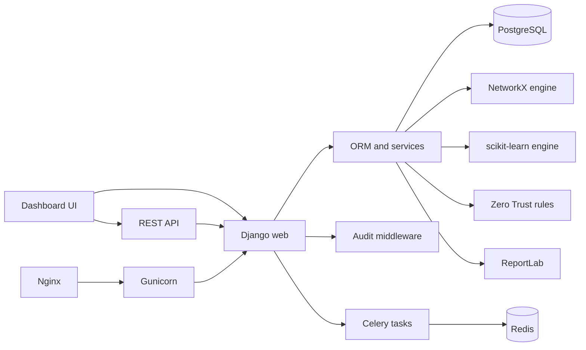

# Architecture

## System diagram

## Request flow

1. A user signs in with session auth or obtains a JWT access token.
2. The dashboard calls Django views or REST endpoints.
3. Organization-scoped viewsets filter records by the authenticated user's organization.
4. Analysis services evaluate permissions, graphs, events and Zero Trust rules.
5. Findings are persisted with evidence and shown in the review queue.
6. Reports render current findings and metrics into PDF files.
7. State-changing requests are recorded in the audit trail.

## Module map

| Module | Responsibility |
| --- | --- |
| `accounts` | Custom user, platform roles and registration |
| `organizations` | Tenant-style synthetic workspace |
| `identities` | Teams and identity profiles |
| `access` | Roles, permissions, assignments, resources, events and reviews |
| `analysis` | Findings, anomaly results, assessments, engines and tasks |
| `reports` | PDF evidence packs |
| `audit` | Sanitized administrative event history |
| `dashboard` | Metrics aggregation and UI views |
| `certification` | Access certification campaigns, reviewer decisions and revocation workflow |
| `config` | Settings, routing, API router, Celery and middleware |

## Deployment topology

The Docker stack contains PostgreSQL, Redis, Django/Gunicorn, Celery and Nginx. Static files are served by WhiteNoise or Nginx from the mounted static volume.
