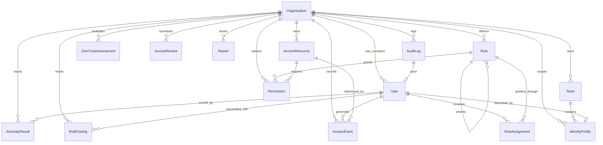

# Entity Relationship Diagram

## Model summary

| Model | Core fields | Purpose |
| --- | --- | --- |
| `User` | `username`, `platform_role`, `organization` | Authentication and RBAC |
| `Organization` | `name`, `slug`, `synthetic` | Workspace boundary |
| `Team` | `organization`, `parent` | Organizational hierarchy |
| `IdentityProfile` | `status`, `mfa_enabled`, `session_timeout_minutes` | Account posture |
| `Permission` | `code`, `risk_weight`, `is_high_risk` | Risk-weighted capability |
| `Role` | `inherits`, `conflicts`, `is_privileged` | Permission bundle and relationships |
| `RoleAssignment` | `user`, `role`, `team`, `active` | Effective access source |
| `AccessResource` | `sensitivity`, `permissions` | Protected asset |
| `AccessEvent` | `event_type`, `occurred_at`, `success` | Behavioral evidence |
| `RiskFinding` | `category`, `severity`, `evidence`, `status` | Reviewable risk evidence |
| `AnomalyResult` | `anomaly_score`, `reasons`, `features` | Explainable outlier result |
| `ZeroTrustAssessment` | `score`, `category_scores`, `recommendations` | Control posture snapshot |
| `Report` | `report_type`, `file`, `summary` | Generated PDF evidence |
| `AuditLog` | `actor`, `action`, `metadata` | Administrative trail |
