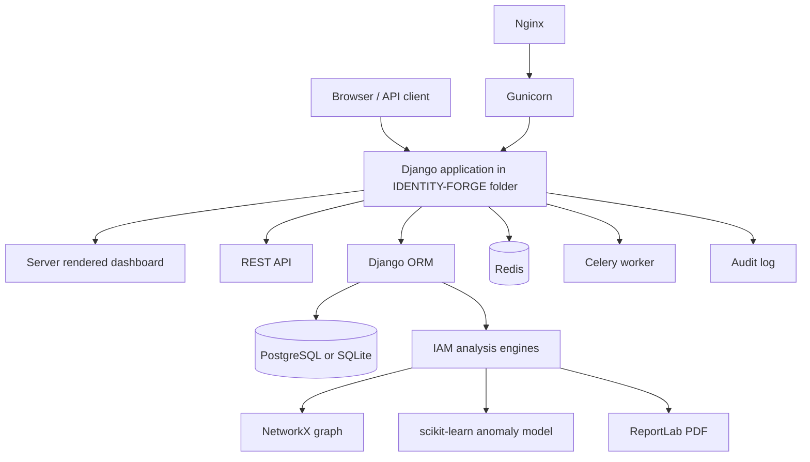
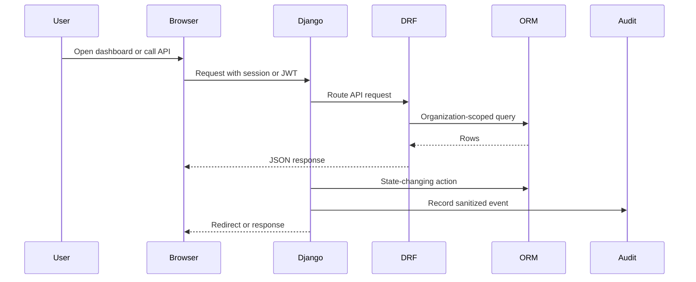
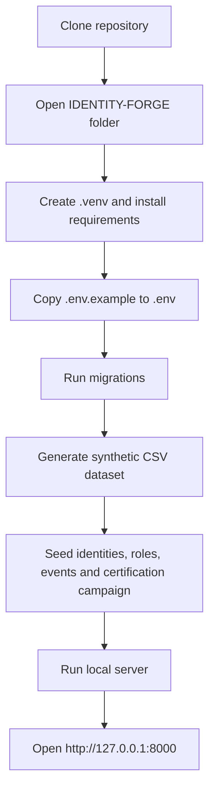
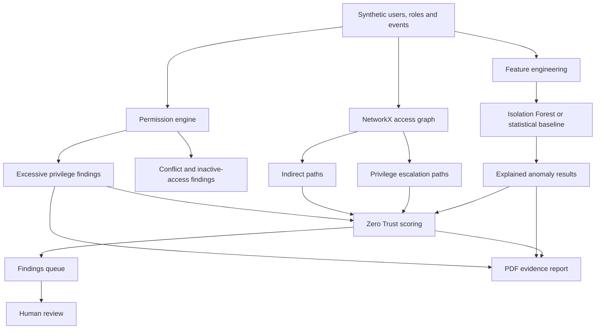
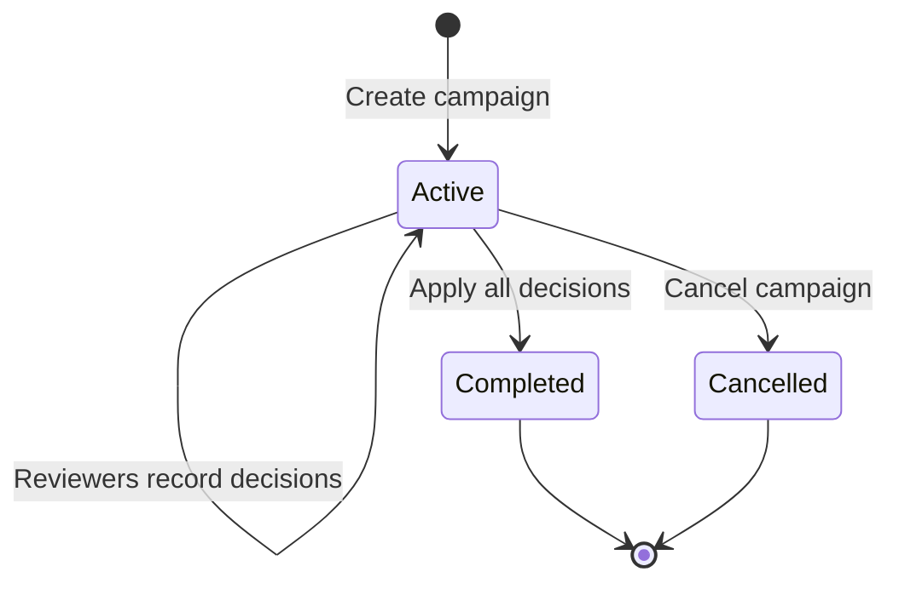

# IDENTITY-FORGE

**IDENTITY-FORGE** is the GitHub repository for **IdentityForge**, a synthetic-data identity and access risk assessment platform. The deployable Django application lives inside the [`IDENTITY-FORGE/`](IDENTITY-FORGE/) folder.

> Synthetic data only. Do not import real identities, real credentials or production access logs.

> Decision support only. IdentityForge does not certify compliance and does not perform unauthorized privilege escalation.

## Repository at a glance

| Item | Location | Purpose |
| --- | --- | --- |
| Application folder | `IDENTITY-FORGE/` | Complete Django project, REST API, UI, engines, tests and docs |
| Application README | `IDENTITY-FORGE/README.md` | Deep project documentation with full structure, diagrams and workflows |
| Root README | `README.md` | Repository overview, navigation, architecture and deployment map |
| License | `LICENSE` and `IDENTITY-FORGE/LICENSE` | MIT License with author credit `n j bala manikantan` |
| CI workflow | `.github/workflows/ci.yml` | Runs verification from the application subfolder |
| Dependabot | `.github/dependabot.yml` | Keeps subfolder Python and GitHub Actions dependencies current |

## What IdentityForge does

| Area | What it does |
| --- | --- |
| Identity management | Users, teams, profiles, MFA state, session limits and lifecycle state |
| Permission analysis | Effective permissions from direct and inherited roles, excessive high-risk grants and conflicting roles |
| Access graph | NetworkX graph of users, teams, roles, permissions and resources with Three.js visualization |
| Privilege escalation analysis | Reads configured inheritance edges and reports risky paths with evidence and fixes |
| Anomaly detection | Isolation Forest and statistical baselines over real access-event features |
| Zero Trust assessment | Configurable scoring for least privilege, MFA, role separation, sessions, reviews and lifecycle |
| Access certification | Campaigns that snapshot active assignments, capture reviewer decisions and apply explicit revocations |
| Dashboard and reports | Live metrics, charts, audit trail and ReportLab PDF evidence packs |
| Security | RBAC, JWT/session APIs, organization scoping, audit logging and validated CSV imports |

## Full repository structure

```text
IDENTITY-FORGE/
├── README.md
├── LICENSE
├── .github/
│   ├── workflows/
│   │   └── ci.yml
│   └── dependabot.yml
└── IDENTITY-FORGE/
    ├── README.md
    ├── LICENSE
    ├── manage.py
    ├── requirements.txt
    ├── ruff.toml
    ├── Dockerfile
    ├── .env.example
    ├── .dockerignore
    ├── .gitignore
    ├── accounts/
    ├── organizations/
    ├── identities/
    ├── access/
    ├── analysis/
    │   ├── engines/
    │   ├── migrations/
    │   └── tasks.py
    ├── certification/
    │   ├── migrations/
    │   └── templates/certification/
    ├── reports/
    ├── audit/
    ├── dashboard/
    ├── config/
    │   ├── management/commands/
    │   ├── settings.py
    │   ├── urls.py
    │   ├── api.py
    │   ├── permissions.py
    │   └── viewsets.py
    ├── templates/
    ├── static/
    ├── samples/data/
    ├── docs/
    ├── docker/
    ├── scripts/
    ├── tests/
    ├── staticfiles/
    └── media/
```

## Module responsibility map

| Module | Responsibility |
| --- | --- |
| `accounts` | Custom user model, registration, JWT/session identity and RBAC role field |
| `organizations` | Synthetic tenant-style workspaces |
| `identities` | Teams, hierarchy and identity profiles |
| `access` | Permissions, roles, inheritance, conflicts, assignments, resources, events and reviews |
| `analysis` | Findings, anomaly results, Zero Trust assessments, graph engine and analysis tasks |
| `certification` | Access certification campaigns, reviewer decisions and explicit revocation workflow |
| `reports` | PDF evidence packs generated from live database records |
| `audit` | Sanitized administrative event history |
| `dashboard` | Metrics aggregation, charts and authenticated UI views |
| `config` | Settings, routing, API router, Celery, middleware and management commands |
| `samples` | Deterministic synthetic dataset generation |
| `tests` | Automated coverage for security, access, graph, AI, reports, UI, exports and certification |

## High-level architecture



## Request lifecycle



## Main workflows

### Setup and seed



### Risk analysis



### Access certification



## Quick start

From the repository root:

```powershell
cd IDENTITY-FORGE
scripts\setup.ps1
scripts\dev.ps1
```

Open `http://127.0.0.1:8000`.

Seeded accounts use `.invalid` usernames and the synthetic password `SyntheticPass!123`.

## Verification

```powershell
cd IDENTITY-FORGE
scripts\verify.ps1
```

The verification path covers Ruff lint, Ruff formatting, Django checks, migration drift, the automated test suite and the deployment health command. Latest verified suite: **61 tests passing**.

## Docker deployment

```powershell
cd IDENTITY-FORGE
Copy-Item .env.example .env
docker compose -f docker\docker-compose.yml --env-file .env up --build -d
```

The stack includes PostgreSQL, Redis, Django/Gunicorn, Celery and Nginx on `http://localhost:8080`.

## Documentation index

| Document | Purpose |
| --- | --- |
| `IDENTITY-FORGE/README.md` | Complete project guide, structure, tables, diagrams and workflows |
| `IDENTITY-FORGE/docs/architecture.md` | System architecture |
| `IDENTITY-FORGE/docs/api.md` | REST API reference |
| `IDENTITY-FORGE/docs/er-diagram.md` | Entity relationship model |
| `IDENTITY-FORGE/docs/risk-engine.md` | Scoring and analysis logic |
| `IDENTITY-FORGE/docs/certification.md` | Certification workflow |
| `IDENTITY-FORGE/docs/security.md` | Security controls and boundaries |
| `IDENTITY-FORGE/docs/deployment.md` | Deployment and operations |
| `IDENTITY-FORGE/docs/compliance-disclaimer.md` | Limitations and acceptable use |

## License

MIT License. Copyright (c) 2026 **n j bala manikantan**. See `LICENSE` and `IDENTITY-FORGE/LICENSE`.

IdentityForge is a demonstration and assessment workspace. It is not a production IAM control plane and does not replace qualified security review.
